# HR Analytics: Employee Attrition Analysis

**Who leaves, and where should HR look first?**
An end-to-end analysis of 5,000 employee records using **Excel, SQL Server, Python and Power BI**.


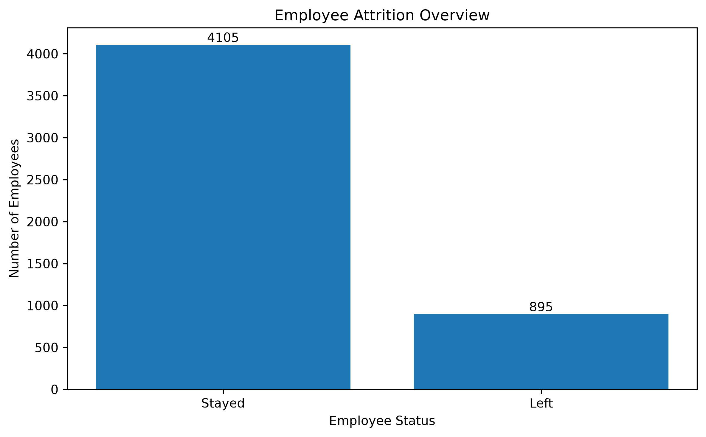

---

## Business Problem

An organization wants to understand its workforce: who stays, who leaves, and where attrition is highest. HR managers need clear, filterable numbers to decide where to investigate first.

**Objectives**

1. Measure overall attrition and retention.
2. Find which departments have higher attrition.
3. Compare attrition by gender, education, age, income, tenure and job satisfaction.
4. Build an interactive dashboard that management can filter and explore.

---

## The Short Version

| | |
|---|---|
| **Attrition rate** | **17.9%** (895 of 5,000 employees left) |
| **Highest department** | HR at 20.84%, then IT at 19.56% |
| **Lowest departments** | Finance (16.04%) and Marketing (16.08%) |
| **Tenure hot spot** | Employees with 3 to 5 years at the company leave at about 20% |
| **Satisfaction** | Not a clean trend. Level 1 is highest (19.92%), but level 4 (18.51%) beats levels 2 and 3 |
| **Statistical check** | Department differences are borderline (p = 0.063). Gender and education differences are not significant |

The honest takeaway: attrition is spread fairly evenly across the workforce. HR and IT stand out, but the gap is small enough that it needs more evidence before anyone acts on it.

---

## Dashboard Preview

Built in Power BI Desktop. Four pages with KPI cards, slicers, comparison charts and an employee-level table.
### HR Overview
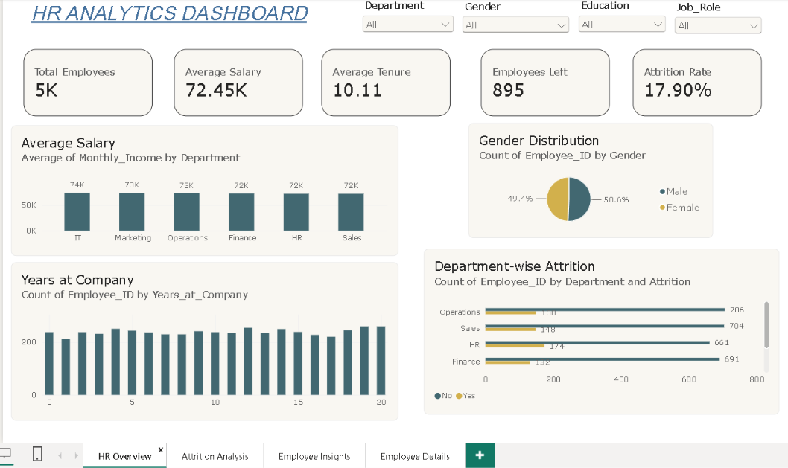


### Attrition Analysis
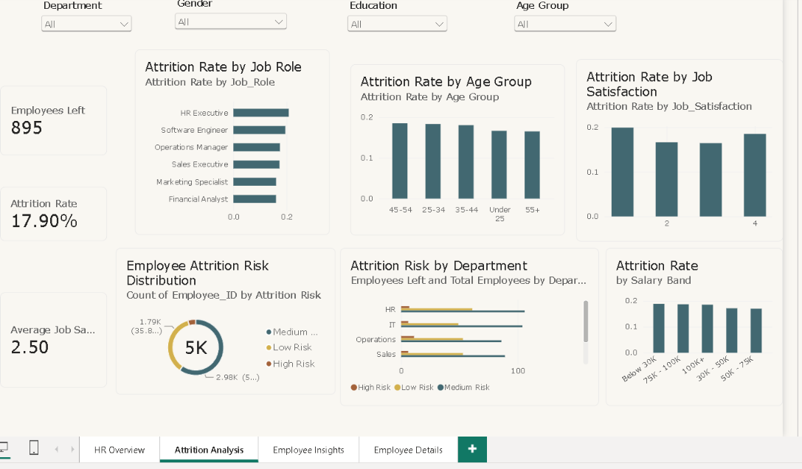


### Employee Insights
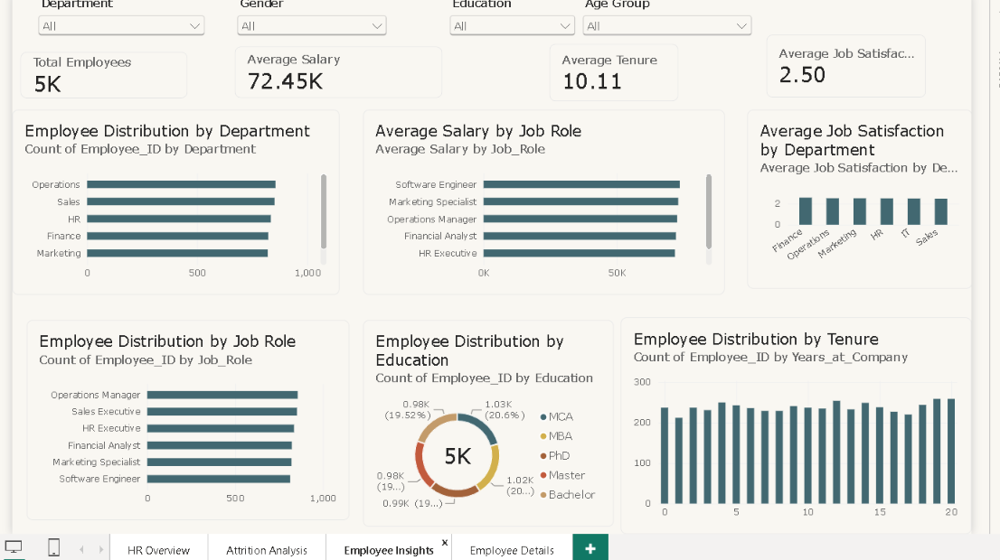

### Employee Details
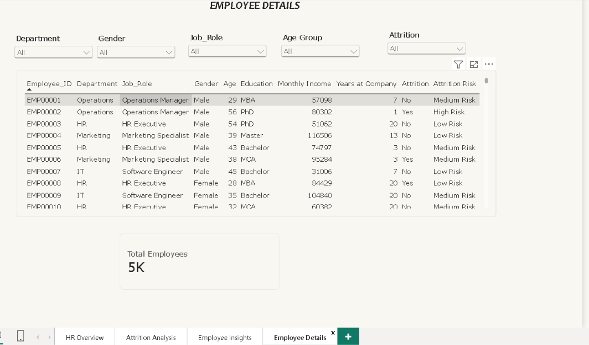
---

## Business Questions

1. What share of employees left, and what share stayed?
2. How does attrition differ by department?
3. How does it differ by gender, satisfaction, age, tenure, income and education?
4. Which patterns deserve a closer look, and what evidence is still missing?

---

## Key Metrics

| Metric | Value |
|---|---:|
| Employee records | 5,000 |
| Left | 895 |
| Stayed | 4,105 |
| Attrition rate | 17.90% |
| Retention rate | 82.10% |
| Average age | 41.19 years |
| Average monthly income | ₹72,447 |
| Average tenure | 10.11 years |
| Average job satisfaction | 2.50 / 4 |

**Attrition rate** = employees who left ÷ total employees × 100
Example: 895 ÷ 5,000 × 100 = 17.90%

**Department attrition rate** = leavers in the department ÷ employees in that department × 100
Example: HR is 174 ÷ 835 × 100 = 20.84%. The denominator is the department headcount, not total leavers.

---

## Findings

### 1. Department

| Department | Employees | Left | Attrition rate |
|---|---:|---:|---:|
| HR | 835 | 174 | **20.84%** |
| IT | 813 | 159 | 19.56% |
| Operations | 856 | 150 | 17.52% |
| Sales | 852 | 148 | 17.37% |
| Marketing | 821 | 132 | 16.08% |
| Finance | 823 | 132 | 16.04% |

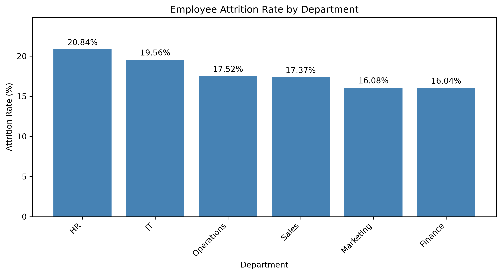

HR sits about 3 points above the company average. A 95% confidence interval for the HR rate runs from roughly 18.1% to 23.6%, so the true figure could be close to the company average.

**Note on job roles:** each department has exactly one job role in this data. Role-level results repeat the department results and are not a separate finding.

### 2. Job satisfaction

| Score | Attrition rate |
|---:|---:|
| 1 | 19.92% |
| 2 | 16.64% |
| 3 | 16.43% |
| 4 | 18.51% |

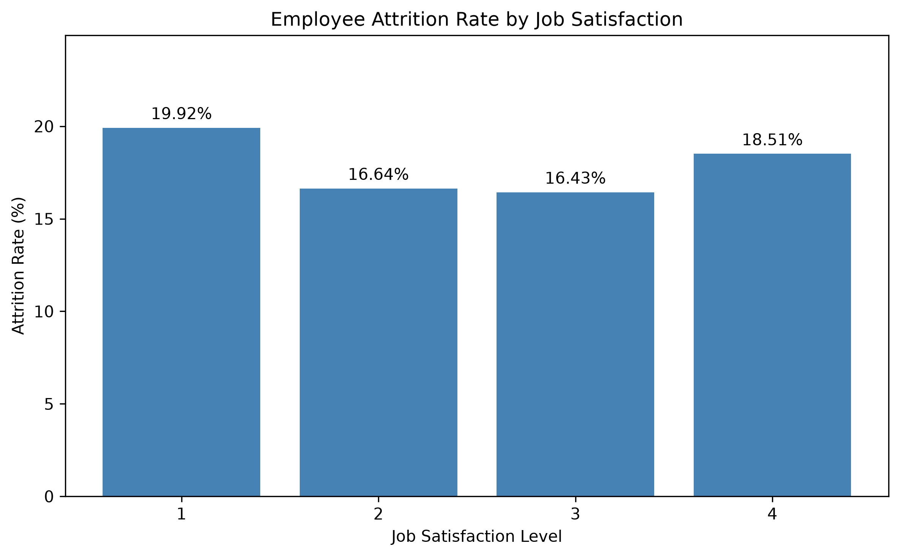

The pattern is U-shaped, not a straight line. Low scores are linked to higher attrition, but highly satisfied employees also leave more often than the middle groups. A single satisfaction score does not explain who leaves.

### 3. Tenure

Attrition rises for employees with 3, 4 and 5 years at the company (20.8%, 20.4% and 20.2%), compared with 14.6% at year 1. Individual years are small groups of about 230 people, so this is a lead to follow, not a conclusion.

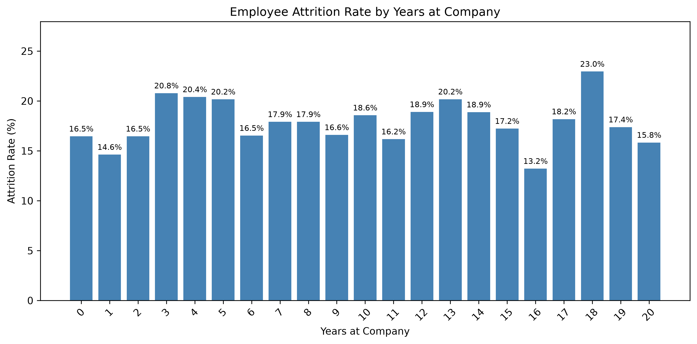

### 4. Gender, education, age and income

| Group | Range of attrition rates |
|---|---|
| Gender | Female 18.58%, Male 17.23% |
| Education | Bachelor 16.70% up to Master 19.51% |
| Age group | 16.52% (55+) up to 18.51% (45 to 54) |
| Income group | 17.49% up to 18.54% |

These gaps are small. Gender and education differences are not statistically significant in this sample (p = 0.23 and p = 0.38).

<details>
<summary>More charts</summary>

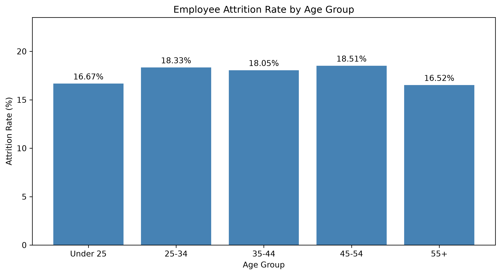
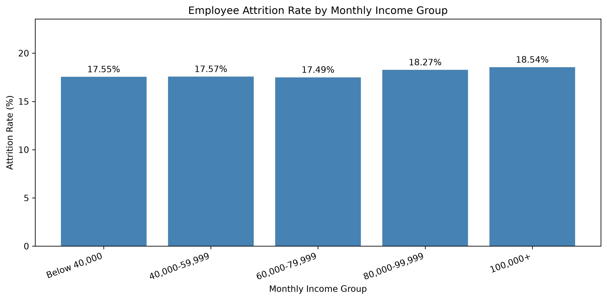
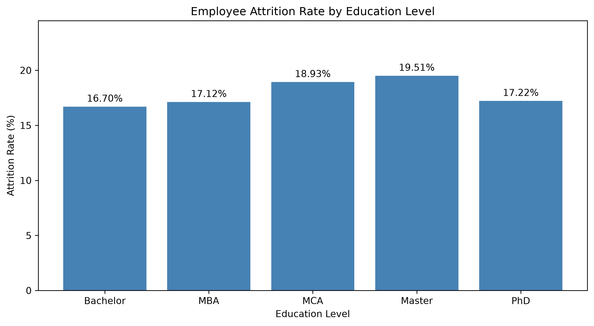

</details>

---

## How Strong Is the Evidence?

I ran chi-square tests on the main groupings to see whether the gaps could be random noise (`python/significance_tests.py`).

| Comparison | p-value | Reading |
|---|---:|---|
| Department (all six) | 0.063 | Borderline, not significant at 5% |
| Job satisfaction | 0.073 | Borderline |
| Gender | 0.227 | No clear difference |
| Education | 0.385 | No clear difference |

HR versus all other departments gives p = 0.017. That test was chosen after seeing the numbers, so it should be treated as a lead and not as proof.

---

## Recommendations

These are next steps, not proven fixes.

1. **Look at HR and IT first.** Review exit interviews, workload, manager feedback and career paths in both teams.
2. **Study the 3 to 5 year group.** Find out whether career growth or promotion timing explains the bump.
3. **Treat satisfaction as one signal.** Check how the 1 to 4 score is collected and pair it with other feedback.
4. **Compare pay in context.** Income groups show almost no difference here, so test pay against role, tenure and market data before drawing conclusions.
5. **Add time-based data.** Monthly or quarterly leaver records would show whether these patterns last.

---

## Tools and Workflow

| Tool | What it was used for |
|---|---|
| **Excel** | Power Query cleaning, PivotTables, first-pass charts |
| **SQL Server** | About 40 queries: counts, rates by group, filtering, sorting, data-quality checks |
| **Python** (Pandas, Matplotlib, SciPy) | Validation checks, grouped attrition tables, 8 charts, 9 CSV exports, chi-square tests |
| **Power BI** | Four-page report: HR Overview, Attrition Analysis, Employee Insights, Employee Details |

**Workflow:** inspect data → check quality → explore in Excel → query in SQL → analyze and chart in Python → report in Power BI → interpret with care.

**Data quality results:** no missing values, no duplicate employee IDs, no duplicate rows.

**Power BI:** I designed and built the four-page report myself, including the KPI cards, filters, visuals and employee-level detail page.

---

## Key Skills Demonstrated

| Area | What I did |
|---|---|
| **Data cleaning** | Power Query preparation, missing-value and duplicate checks |
| **Excel** | PivotTables, charts, preliminary metric checks |
| **SQL (SQL Server)** | `GROUP BY`, aggregates, `HAVING`, filtering, sorting, attrition rate by group |
| **Python** | Pandas grouped metrics, Matplotlib charts, CSV exports, chi-square tests |
| **Power BI** | KPI cards, slicers, custom measures and fields (Attrition Rate, Age Group, Salary Band, Attrition Risk), drill-through, four-page layout |
| **Analysis** | Attrition and retention metrics, group comparisons, significance testing |
| **Business reporting** | Findings, limitations and next steps written for HR managers |

---

## Dataset

**File:** `Data/hr_employees.csv` (5,000 rows, 10 columns)

| Column | Description |
|---|---|
| `Employee_ID` | Record identifier |
| `Age` | Age in years |
| `Gender` | Gender category |
| `Department` | Finance, HR, IT, Marketing, Operations, Sales |
| `Job_Role` | Role category (one per department) |
| `Education` | Bachelor, MBA, MCA, Master, PhD |
| `Monthly_Income` | Monthly income (currency not defined in the data) |
| `Years_at_Company` | Tenure in years |
| `Job_Satisfaction` | Score from 1 to 4 |
| `Attrition` | `Yes` = left, `No` = stayed |

---

## Repository Structure

```text
HR_Analytics_Project/
├── Dashboard/
│   ├── HR_Analytics_Dashboard_final.pbix
│   └── screenshots/         # add your 4 page screenshots here
├── Data/
│   └── hr_employees.csv
├── excel/
│   ├── CLEANING DATA/HR_Analytics_Data_Cleaning.xlsx
│   └── HR_Analytics_Project_Recovered.xlsx
├── Output/
│   ├── Analysis Table/      # 8 attrition CSVs
│   └── Charts/              # 8 PNG charts
├── python/
│   ├── hr_analysis.py
│   └── significance_tests.py
├── SQL/
│   └── SQLQuery4.sql
├── hr_summary.csv
└── README.md
```

---

## How to Run

**Python**

```bash
pip install pandas matplotlib scipy
cd HR_Analytics_Project
python python/hr_analysis.py
python python/significance_tests.py
```

Run it from the project root so the CSV path resolves. The script saves charts and CSVs to the current folder. Close each chart window to let it continue. I moved the generated files into `Output/` by hand.

**SQL Server**

1. Create the `HR_Analytics` database and import the CSV into `dbo.hr_employees`.
2. Convert `Attrition` to numbers during import (`Yes` = 1, `No` = 0). The queries compare against 1 and 0, and the CSV holds text.
3. Open `SQL/SQLQuery4.sql` in SSMS and run it.

**Power BI**

Open the `.pbix` file in Power BI Desktop. If it asks for a data source, point it to your local `Data/hr_employees.csv`.

---

## Limitations

- The data is synthetic, so results do not apply to a real company.
- The analysis is descriptive. It shows where attrition is higher, not why.
- Group differences are small and most are not statistically significant.
- Department and job role overlap completely.
- There is no time dimension, so trends cannot be measured.
- No predictive model is built.

---

## Author

**Neha Umesh Patil**
[LinkedIn](https://www.linkedin.com/in/neha-patil-907a602b1) · [GitHub](https://github.com/NehpatilData)
